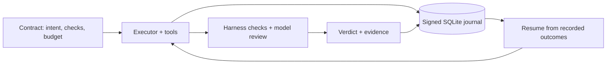

# Truss

[Website](https://controlstackai.github.io/truss/) · [Documentation](https://controlstackai.github.io/truss/guide/)

**A Rust agent harness for work you can resume, inspect, and verify.**

[](https://github.com/ControlStackAI/truss/actions/workflows/ci.yml)
[](LICENSE)

Truss runs AI-agent tasks against explicit acceptance criteria. It records execution
in a signed SQLite journal, resumes from recorded results after an interruption,
and produces a verdict from harness-run checks and a separate model-review panel.
The agent saying “done” is not the acceptance test.

[Try the tests](#try-it-without-a-model-account) ·
[Architecture](#how-it-works) ·
[Engineering tour](docs/engineering-tour.md) ·
[Configuration](docs/configuration.md) ·
[Limits](#what-the-evidence-doesand-does-notprove)

> **Status:** development project; workspace version **0.58.0**. This is a
> standalone runtime and CLI, not an OpenClaw fork or a claim of production-scale
> deployment.

## Why build another harness?

A transcript tells you what an agent said. It does not establish that an artifact
meets its requirements, or tell a restarted process which effects already happened.
Truss makes those questions part of the runtime:

| Question | Truss's approach |
|---|---|
| Did the task meet its acceptance criteria? | A TOML contract declares executable checks and model-review clauses. The harness collects their results into a verdict. |
| What survives a restart? | SQLite stores the journal. Resume reconstructs state and reuses recorded model/tool outcomes. |
| Has the record changed? | Hash-chained, Ed25519-signed entries support integrity verification against a trusted key. |
| Where do limits apply? | A shared `Ctx` carries cancellation, deadlines, budgets, policy, and events through provider and tool calls. |
| Can execution backends change? | Provider traits and a separate provider crate keep vendor-specific model code out of the runtime. Delegated CLI execution is another supported path. |

## Try it without a model account

Prerequisites: a current stable Rust toolchain, a C/C++ build toolchain for bundled
SQLite, Git, and a Unix-like shell. Dependency downloads require network access on
the first build; the tests below use deterministic fake providers, not paid APIs.

```sh
git clone --depth 1 https://github.com/ControlStackAI/truss.git
cd truss

cargo test --locked -p truss-core --test durable_test
```

The named tests provide a short, executable tour:

| Test | What it exercises |
|---|---|
| `contract_fails_when_a_check_fails` | A completed executor cannot override a failing acceptance check. |
| `suspend_on_signal_then_resume_after_delivery` | A suspended run waits for a signal, then resumes with prior context. |
| `recorded_steps_are_not_re_executed` | Resume reuses journaled outcomes rather than rerunning recorded tools. |
| `tamper_breaks_the_chain` | Changing a journal payload is detected. |
| `corrupt_signature_breaks_verification` | An invalid signature fails verification. |
| `review_panel_fails_without_majority` | Review requires a strict majority, not one favorable reviewer. |

These are runtime integration tests with controlled providers. They do not measure
live-model task quality, production reliability, or benchmark superiority.

## Build and run

```sh
cargo build --locked --release -p truss-cli
./target/release/truss --help
```

For a live run, configure a supported provider using
[the configuration guide](docs/configuration.md). Default builds include Anthropic
and OpenAI-compatible providers. API-backed execution and model review can incur
charges; the credential-free tests above do not.

With `ANTHROPIC_API_KEY` already configured, run the
[minimal greeting contract](examples/contract.toml):

```sh
./target/release/truss --contract examples/contract.toml --tools
./target/release/truss --verify demo-greeting-0001 --db harness.db
```

The contract writes `greeting.txt` in the working directory and stores run state
in `harness.db`; use a disposable checkout for exploration. A contract defines
intent, `check`/`review` clauses, budget, and constraints. For example:

```toml
[[done]]
kind = "check"
desc = "greeting.txt contains exactly the required line"
run = "printf 'hello from the harness\\n' | cmp - greeting.txt"
expect_exit = 0
```

Checks are commands executed by the harness. Review clauses use separate model
calls. A passing model review cannot erase a failing check.

## How it works



Four crates separate runtime, integrations, entry point, and evaluation tooling:

| Crate | Responsibility |
|---|---|
| [`truss-core`](crates/truss-core) | Agent loop, contracts, durable state, signing, tools, policy, memory, and MCP. Vendor-neutral; it does use HTTP for web tools and MCP transport. |
| [`truss-providers`](crates/truss-providers) | Feature-gated model-provider implementations and provider registry. |
| [`truss-cli`](crates/truss-cli) | CLI, configuration, provider/tool wiring, and optional review TUI. |
| [`truss-bench`](crates/truss-bench) | Evaluation and simulated-user tooling, separate from the default CLI/runtime path. |

Other implemented surfaces include MCP client/server integration, child-run and
fan-out machinery, governed memory, and opt-in context compaction. Start with the
[engineering tour](docs/engineering-tour.md) for source and tests rather than
reading the historical roadmap as a feature-status checklist.

## What the evidence does—and does not—prove

- **A verdict is only as good as its criteria.** Shell checks can be incomplete;
  model reviewers can share mistakes. Separate review calls are not statistically
  independent proof of correctness.
- **Replay covers recorded outcomes.** An external effect can happen before its
  result reaches the journal. Exactly-once external effects require downstream
  idempotency or reconciliation; SQLite alone cannot provide that guarantee.
- **Signatures establish record integrity, not truth.** Trust depends on the
  signing key and its custody. Use `--expect-key` to pin an expected public key.
  A local anchor log is not an independently operated timestamping service.
- **Default execution is not a security sandbox.** `NoSandbox` is the default.
  Working-copy isolation is not kernel or network isolation. Do not treat tool
  policy as containment for hostile code.
- **Delegated execution has a different visibility boundary.** Truss can capture
  a vendor CLI result and verify artifacts, but does not journal that CLI's inner
  tool loop. See [execution/auth modes](docs/auth-strategy.md).

## Documentation and development

- [Engineering tour](docs/engineering-tour.md): implementation, tests, and design tradeoffs.
- [Configuration](docs/configuration.md) and [examples](docs/examples/index.md): CLI and TOML usage.
- [Plugin authoring](docs/plugins/index.md): providers, tools, context, and ledger consumers.
- [Architecture decision records](docs/adr/): design rationale.
- [Documentation index](docs/SUMMARY.md): the full collection, including historical designs.

Some architecture, readiness, and roadmap documents describe earlier milestones or
planned work. Their status is not a current implementation guarantee; follow the
source and tests linked in the engineering tour.

To run the broader checks used by [CI](.github/workflows/ci.yml):

```sh
cargo fmt --all -- --check
cargo clippy --workspace --all-targets --all-features -- -D warnings
cargo test --workspace --all-features
```

Keep changes scoped and include a regression test for runtime behavior changes.
Do not commit provider credentials, run databases, or signing keys.

See [CONTRIBUTING.md](CONTRIBUTING.md) for the development workflow and
[SECURITY.md](SECURITY.md) for private vulnerability reporting.

## Attribution and license

An independent, AI-assisted ControlStackAI project led by Matthew Mangano.
OpenClaw informed gateway/persistence patterns; Claude Code informed hooks and
headless-executor integration; Hermes informed the small-runtime approach.
Provider APIs and dependencies retain their respective ownership and terms.

Truss is licensed under the [MIT License](LICENSE).
