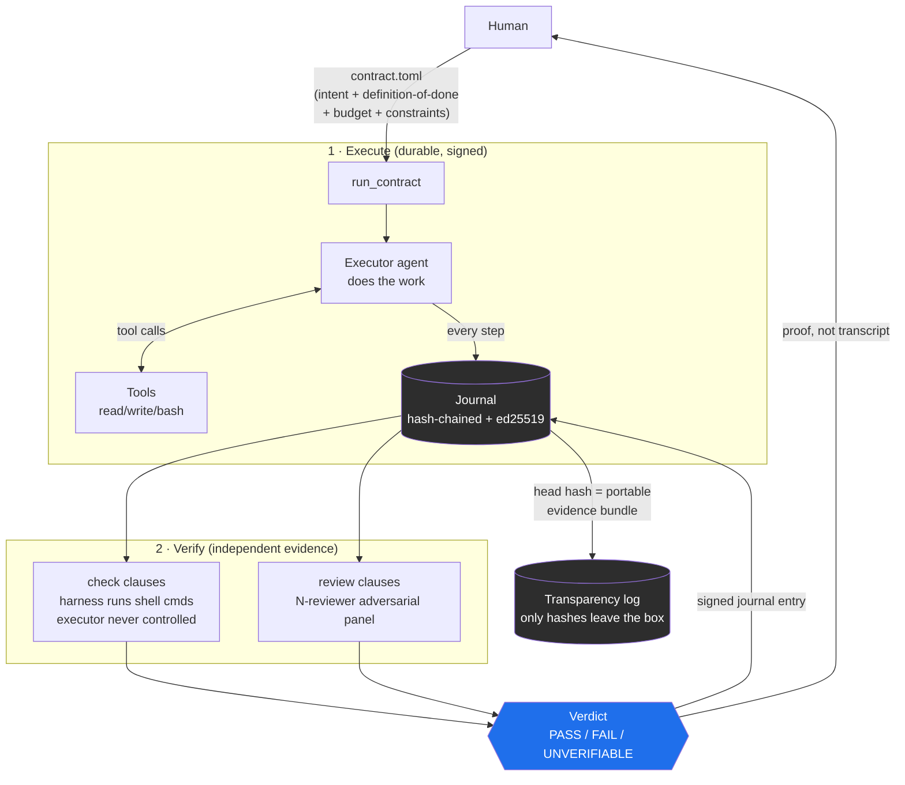
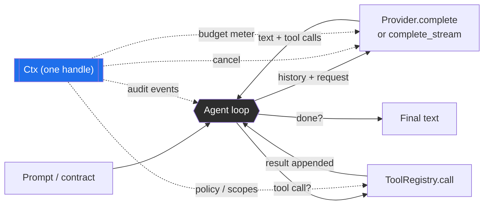
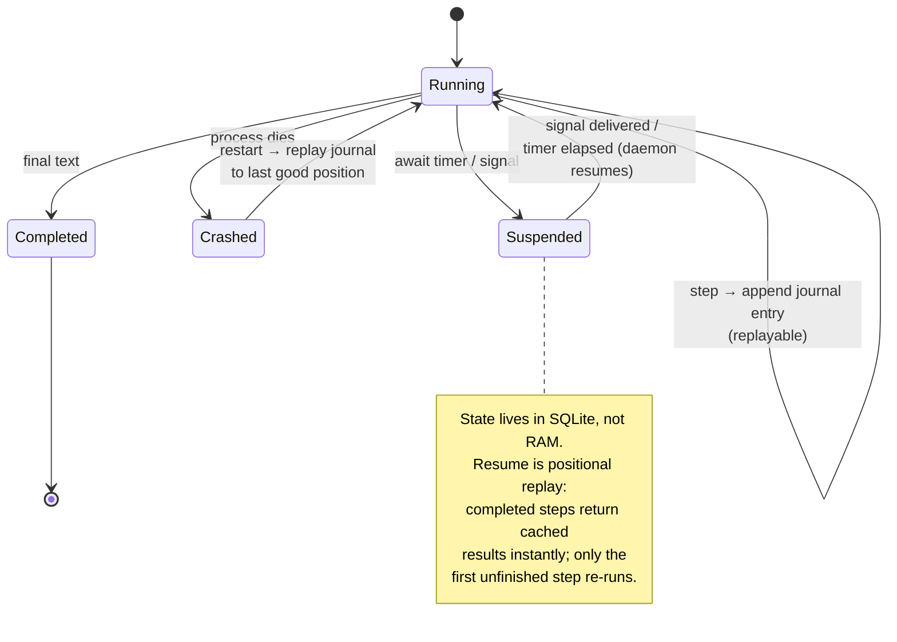
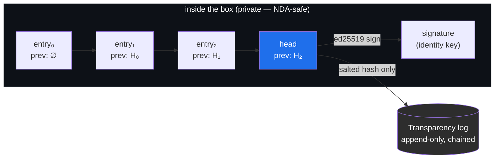
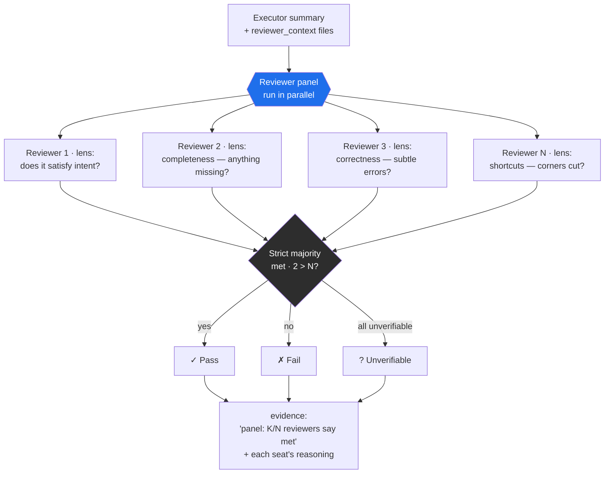
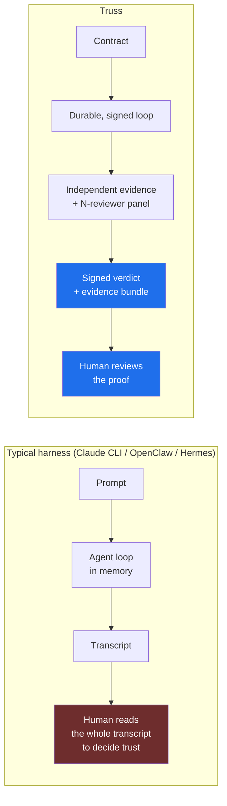
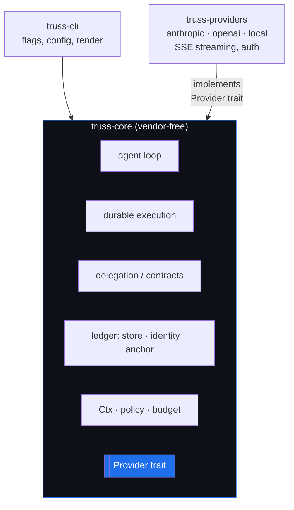

# Truss — Architecture & How It Differs

> **Thesis:** generation isn't the bottleneck anymore — *trust* is. Truss is a
> durable, verifiable agent runtime. You delegate work as a **contract** and review
> a **signed verdict backed by independent evidence** — not a transcript.

This document is the map. Each diagram describes how a part of the harness is
*intended* to work; the implementation is held to match it.

---

## 1. The big picture — contract in, signed verdict out

Everything else in Truss exists to make this one path trustworthy.

**The invariant:** the executor *never grades its own homework*. Checks run in an
environment it didn't control; reviewers are separate model/contexts prompted to
refute. The human sees a verdict + evidence, not a wall of tool calls.

---

## 2. The harness loop — one `Ctx` threads every concern

A provider API is stateless: one request in, one response out. The *harness* is the
loop around it. Truss threads a single `Ctx` handle into every model and tool call,
so cancellation, budget, policy, and audit all flow through one place — adding a
cross-cutting concern later puts a field on `Ctx`, it never re-breaks signatures.

- **Cancellation** — Ctrl-C aborts the in-flight model call *and* any running child
  process; the partial event log is flushed.
- **Budget** — hard ceilings on USD / tokens / steps, checked before each call.
- **Policy** — write-scope, read-scope, network mode, tool allowlist, forbidden
  substrings — enforced at the tool boundary, not by trusting the model.

---

## 3. Durable execution — suspend, crash, resume, replay

A contract run is event-sourced. Each step is a journal entry; the agent state is
rebuilt by replaying entries (positional replay). This is what lets a run survive a
crash, suspend on an external await (timer / signal), and resume exactly where it
left off — without re-doing or double-charging completed work.

**Why it matters:** most harnesses keep the loop in memory — kill the process and
the run is gone. Truss treats a run like a database transaction log. The same
mechanism powers human-in-the-loop pauses and long-horizon (hours/days) work.

---

## 4. The verifiable ledger — hash chain → sign → anchor

Every journal entry is content-addressed and chained to its predecessor, then the
head is signed. Tampering with any past entry breaks the chain. Periodically the
head hash is anchored to an external append-only transparency log — so even the
machine that produced the run can't silently rewrite history.

**Privacy invariant:** *only salted hashes leave the box.* Evidence content (which
may be NDA / client work) is never put on-chain or in the anchor log. Anchoring
proves *when* a head existed, not *what* it contained. `--verify` re-walks the chain
and checks the signature; `--verify-anchor-log` checks the anchor log's own chain.

---

## 5. N-reviewer adversarial verification

A single reviewer is a single point of failure — a lenient model waves bad work
through. Truss convenes a **panel of N independent reviewers** for each `review`
clause. They run in parallel, each assigned a different *lens*, each prompted to
refute. A strict majority must say "met" or the clause fails. Unverifiable votes
count as not-met (default-to-fail). All-unverifiable → the clause is Unverifiable.

Lenses are assigned round-robin, so even a panel of *one model* gets perspective
diversity. Set the size with `reviewers = N` in the contract or `--reviewers N`.
(Diverse *models* per seat is a planned enhancement — the panel is already a
`Vec<Arc<dyn Provider>>`.)

---

## 6. How Truss differs from other harnesses

Most harnesses optimize **generation** — get the model to produce the artifact.
Truss optimizes **trust** — let you accept the artifact without re-reading the work.

| Dimension | Typical harness | **Truss** |
|---|---|---|
| Unit of work | prompt | **contract** (intent + checkable done + budget + constraints) |
| What you review | transcript | **signed verdict + independent evidence** |
| Who verifies | the executor (self-reported "done") | **harness-run checks + N-reviewer adversarial panel** |
| Run state | in-memory; dies with the process | **durable journal (SQLite); suspend / crash / resume** |
| Audit | logs you trust | **hash-chained, ed25519-signed ledger; externally anchored** |
| Privacy | n/a | **only salted hashes leave the box (NDA-safe)** |
| Provider lock-in | usually one vendor | **`Provider` trait; core is vendor-free, providers are plugins** |

---

## 7. Crate layout — small, vendor-free core

The moat is in the core; vendors are swappable plugins. The core has *no* vendor
code and *no* `reqwest` — it depends only on the `Provider` trait.

See [`adr/0001-plugin-architecture.md`](adr/0001-plugin-architecture.md) for why the
core stays small and how providers plug in, and
[`auth-strategy.md`](auth-strategy.md) for the provider-agnostic auth model
(API key / OAuth subscription / CLI subprocess).
